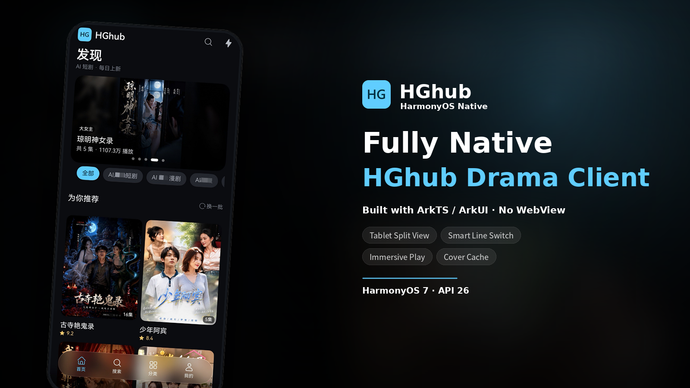
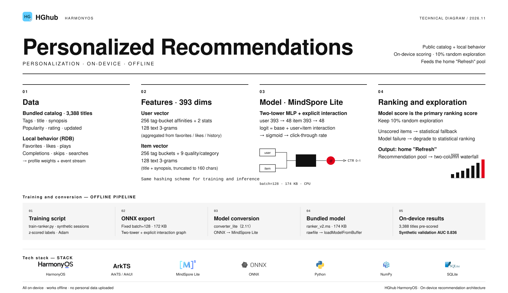
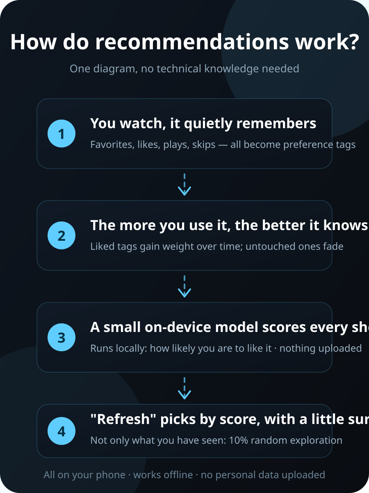

> **Disclaimer**: This is a personal open-source project for learning HarmonyOS client development, intended for programming study only. All resources loaded inside the app come from the internet and are unrelated to the developer. Do not misuse; for learning purposes only.

  

<h1 align="center">HGhub Harmony</h1>

  <strong>Bringing HGhub short dramas to HarmonyOS</strong> 
  A fully native third-party short-drama client built with ArkTS / ArkUI for browsing, episode picking and immersive playback.

  
  
  
  

  

  <strong>English</strong> · <a href="README.md">简体中文</a>

---

## A fully native HGhub client for HarmonyOS

The HarmonyOS client for HGhub short dramas, written directly in **ArkTS / ArkUI** on the Stage model with native system components — no WebView, no embedded H5.

Discovery, search, categories, rankings, the community feed, detail pages, episode picking and immersive vertical playback are all carried by native components, native gestures, a native player and native system capabilities. The tab bar uses the system's immersive material, and the playback pipeline ships with preloading and a local media cache.

  

> This project has no affiliation with the content provider. For learning and personal use only.

## Native UI, complete browsing and playback

Open the app and the content is there; swipe and you are on the next episode.

The home page opens with a hero recommendation and a two-column waterfall; switching tags does not repaint the whole screen. Search, categories, rankings and the community feed each get their own page, showing a skeleton first and fading real content in. Tapping into a detail page gives you the cover, synopsis, episode grid and a resume entry on one screen.

The player is the heart of the experience: AVPlayer decodes HLS directly and hands the picture to XComponent — no WebView, no embedded H5. Swipe vertically to switch dramas one at a time, swipe horizontally to seek, long-press for 2x, tap to hide the controls. Episodes, comments, details and line selection all live in native sheets that never interrupt the video.

Comfortable to watch, and steady:

| Smooth | Steady |
| --- | --- |
| Native gestures and a native player — scrolling, switching and seeking all track your finger | Tiered retries on playback URL failures; automatic fallback to standard quality when HD is unavailable |
| Dark is the design baseline; the player stays dark and text on video keeps scrim contrast | Line latency is visible; consecutive failures switch lines automatically, and mirrors can return to the primary |
| Floating immersive tab bar with system material; content extends behind it | Crash / playback / performance diagnostics stay on-device and export as a zip for issues |

**Also included**: sharing goes through the system share sheet (falling back to copying the link), and a shared link in the clipboard can launch playback in one tap. The network layer reuses connections per host to cut TCP/TLS handshakes and prefers IPv6 when the target supports it. An `HD`/`SD` badge appears next to the title when an HEVC source exists — tap to switch while keeping your position. Dragging the progress bar to the end auto-plays the next episode. The lock screen and Control Center can control playback, and picture-in-picture keeps it going on the desktop. Playback context can continue onto another HarmonyOS device, and same-network devices support casting. Home-screen cards cover 2×2 continue-watching (large cover with a top label) and a 2×4 favorites shelf (3:4 portrait covers). Topic collections, live trending searches, a follow feed and user profiles are all in place. On cold start the app checks for updates in the background and shows a single dialog when one is found — tap "Open download link" to go straight to the release page.

## Tablet / landscape / split view

One codebase, following the window.

On a phone it is a single immersive column; rotate to a tablet or landscape and the layout reflows live with the window — the waterfall goes from 2 to 3/4 columns, the episode grid from 5 to 6/7, content is centered at up to 960vp, and rotating, splitting or folding never rebuilds the player.

At ≥840vp the default is still a **full-width multi-column waterfall** (no premature split). Opening a drama or a page animates into split view: the list stays on the left, details or playback appear on the right, with transitions both ways. In the player you can tap "Full screen" to temporarily fill the window and return to split view when you exit. In landscape the comment section collapses into a ~380vp sidebar on the right, with independent pagination and refresh that never interrupts the video.

> **Tablet / large-screen / PC note**: the developer has no tablet device, so tablet layouts (split view, multi-column waterfall, full-screen toggle) have not been verified on real hardware. If you hit UI or interaction issues on a tablet or large screen, please report them via [GitHub Issues](https://github.com/stlin256/HGhub-Harmony/issues). Tablet users also see an in-app notice once after each update.

## Personalized recommendations (on-device, offline)

"For you" is not a random shuffle — it is ranked to your taste.

A public catalog of 3,388 titles ships with the app. A small on-device model combines it with your local behavior (favorites, likes, plays, completions, skips, searches) to score every title, keeping about 10% random exploration so recommendations do not narrow over time. The whole pipeline runs on your phone: no personal data is uploaded, and it works offline.

| Stage | Approach |
| --- | --- |
| Data | Bundled catalog of 3,388 titles + local behavior events (SQLite) |
| Features | 393 dimensions: tag buckets + quality/category + character 3-grams of title and synopsis |
| Model | MindSpore Lite two-tower MLP, 174 KB, validation AUC 0.836 |
| Fallback | Automatically degrades to statistical ranking when the model is unavailable |

To see how it works, open **Settings → Recommendations**: "Recommendation data" shows your local profile tags and scoring status and lets you import/export the profile; "How recommendations work" explains the idea with a few native step cards.

One-diagram version for non-technical readers (same as Settings → Recommendations → How it works)

  

## Less waiting, clearer state

| **Smooth** | **Clear** |
| --- | --- |
| Skeletons mirror the real layout and content fades in over 220ms; covers are decoded at display size and decrypted on a TaskPool background thread, so lists scroll without dropped frames. | Three levels of error state — page, section and inline; loaded content is kept while retrying, so a failure is never just a toast. |
| In-memory LRU plus a persistent disk cache for covers (cache keys drop signature params), so cold starts and repeat browsing are instant. | Buffering, start-up and failure all have explicit states; episodes/comments/details/lines share native sheets. |
| HLS preloading: the first segments of the next episode and the next two feed items are fetched ahead, paired with a local loopback proxy media cache — switching episodes and swiping up are noticeably faster. | Playback failures distinguish transient state errors from real ones, so "the first tap does not play" no longer happens; the back key asks for confirmation before exiting. |
| Home and ranking prefetch with early pagination; the three ranking tabs preload in parallel and render immediately when switched, with no skeleton flash. | Dark is the design baseline and the player stays dark; text over video keeps scrim contrast; large fonts and tablet breakpoints are handled. |
| The HdsTabs bar animates page switches over 240ms, and player chrome fades in/out over 140/120ms. | Full-screen playback hides the status bar and restores it on exit; safe areas and immersive layout are handled uniformly. |

> Main interactive elements carry accessibility labels (`accessibilityText`) and work with screen readers and system accessibility services.

## Tech stack

| Layer | Choice |
| --- | --- |
| Language / UI | ArkTS (strict mode) + declarative ArkUI |
| App framework | Stage model, UIAbility + Navigation/NavPathStack + HdsTabs (UIDesignKit floating immersive bar) |
| Playback | @ohos.multimedia.media AVPlayer (HLS) rendered via XComponent; HLS preloading + local loopback proxy media cache |
| Network | @ohos.net.http (unified edge envelope / retries / lines) |
| Crypto | AES-128-CBC cover decryption (on a TaskPool background thread), rendered as PixelMap |
| Image cache | Decode at display size + in-memory LRU + persistent disk cache |
| Storage | @ohos.data.preferences + AppStorage |
| Tooling | DevEco Studio 26.0.0 / HarmonyOS SDK API 26, built with hvigor CLI |

## Usage notes

- **Use it as a normal guest**: browse like any visitor and please do not abuse this project.
- **Upstream APIs may change**: the site APIs are provided by a third party and can change at any time. This project exists for related development learning and **does not guarantee API or request stability**; if a change breaks something, feel free to report it via [Issues](https://github.com/stlin256/HGhub-Harmony/issues) or send a PR.
- **Do not put pressure on the site**: this project provides no download feature. Do not modify the code for bulk downloading or scraping, do not poll aggressively, hammer the APIs concurrently or idle-farm play counts; please do not shrink or disable the built-in cover and playlist caches.
- **Respect content copyright**: do not remove watermarks or site branding, and do not re-upload, transcode, modify or redistribute episodes elsewhere (cloud drives, resource sites, other apps), let alone sell them.
- **Do not publicly share APIs or direct links**: do not post API addresses, playback links or decryption methods publicly or bundle them into a "resource site" — if the site gets blocked, everyone loses access.
- **No commercialization**: selling packaged builds, adding ads / memberships / paid VOD, or distributing as part of a paid service is prohibited (see [LICENSE](LICENSE)).
- **Fair use**: for personal learning, research and self-use only; please delete related resources within 24 hours and support legitimate sources.
- **Follow local law**: users are responsible for judging and complying with their own jurisdiction.

## Disclaimer

- This project has no affiliation with the content provider; the author does not produce, upload or distribute any content.
- This project is released only through this repository's official channels. Any third-party modified build (especially ones with license keys or VIP monetization) is unrelated to this project — please judge for yourself.
- Users must comply with the laws of their own jurisdiction; any consequences of using this project are borne by the user.
- If a rights holder believes this project infringes, please contact us via Issues and we will respond promptly.

## License

[PolyForm Noncommercial License 1.0.0](LICENSE) — **noncommercial use only**.

- **Permitted**: personal learning, research, self-use, hobby projects, and internal use in non-profit organizations; you may modify and build on it freely.
- **Prohibited**: any commercial use, including but not limited to selling packaged builds, ads / memberships / paid monetization, or distributing it as part of a paid product or service.
- **Notice retention**: when distributing this project or a modified version, you must include the full license text (or the link above) and the Required Notice line.

> History: early versions were released under MIT, and copies already distributed remain under MIT; versions from **v1.1.0** onward are licensed under PolyForm Noncommercial 1.0.0.

## Upstream and official channels

- **Official download channel**: [GitHub Releases](https://github.com/stlin256/HGhub-Harmony/releases). No executables are hosted on the source page; any "HGhub" installer distributed by other websites, cloud drives, QQ groups, WeChat accounts or third-party download sites is unofficial, and the author cannot vouch for its safety or integrity.
- 🚫 **Known malicious modifications**: any build that adds license-key verification, VIP paid unlocks or similar monetization on top of older source code is unrelated to this project — the changes are opaque and cannot be verified as safe. **Do not download, register or pay**; if installed, uninstall it.
- This project **has never and will never** include license keys, VIP, paid unlocks or ads.

## Contributing

Issues and PRs are welcome. Before you start, please read:

- [Implementation SPEC](docs/harmony/SPEC.md) and [Design guidelines](docs/harmony/DESIGN.md)
- [Environment, signing and on-device debugging](docs/harmony/ENVIRONMENT.md)

This is a personal learning project, so Issue / PR responses will be infrequent.

  Built for HarmonyOS with care. PolyForm Noncommercial 1.0.0.

