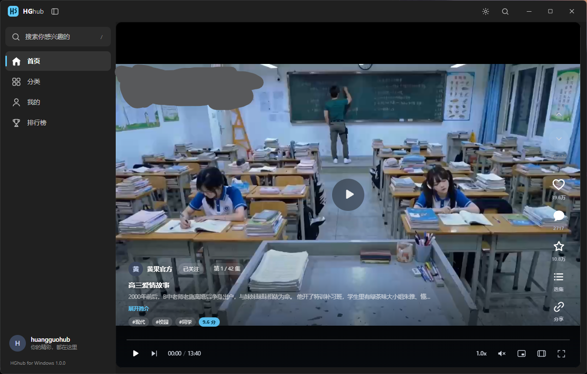

<div align="center">

# HGhub

**黄果短剧第三方客户端 · Rust + Tauri 2**

Windows / macOS / Android 三端 · Fluent 设计 · 沉浸式竖屏播放


</div>

> ⚠️ 本项目仅供 **学习与技术交流**，不提供、不存储、不分发任何音视频内容。
> 所有内容均来自第三方站点，请自行判断合规性，并在 24 小时内删除相关资源。


## 技术栈

| 层 | 选型 |
| --- | --- |
| 壳 | Tauri 2（Rust 1.9x） |
| 前端 | React 19 + TypeScript + Vite 7 + Tailwind CSS 4 |
| 播放 | hls.js（HLS / AES-128） |
| 网络 | reqwest + rustls |

## 目录

```
.
├─ src/                      前端
│  ├─ api.ts                 接口封装 + 本地媒体协议 URL
│  ├─ store.tsx              全局状态（导航栈 / 用户 / 本地收藏 / 主题）
│  ├─ html.ts                吃瓜正文清洗与图片代理
│  ├─ components/            Feed（播放页）/ VideoSurface / PlayerControls / Panels / UI
│  └─ pages/                 Home / Search / Category / Profile / Posts
├─ src-tauri/                Rust 后端
│  └─ src/
│     ├─ net.rs              请求层（边缘信封 + 重试）
│     ├─ api.rs              业务命令
│     ├─ media.rs            封面解密 + HLS 代理 + 缓存
│     └─ session.rs          token 持久化
└─ docs/API.md               接口文档
```

## 开发 / 构建

```bash
pnpm install          # 首次安装
pnpm app:dev          # 桌面端热重载
pnpm app:build        # 打包：Windows → NSIS 安装程序；macOS → .app + .dmg
```

macOS 先装 Xcode Command Line Tools（`xcode-select --install`），打包目标写在
`src-tauri/tauri.macos.conf.json`（`app` + `dmg`，窗口用系统标题栏 Overlay）。

Android（需 Android SDK + NDK，并配置 `ANDROID_HOME` / `NDK_HOME`）：

```bash
pnpm android:init     # 首次生成 android 工程
pnpm android:dev      # 真机 / 模拟器调试
pnpm android:build    # 产出 APK
```

### 环境注意

- 工程若放在 **exFAT** 盘（不支持符号链接），需保留 `.npmrc` 中的 `node-linker=hoisted`。
- pnpm 10 靠 `package.json` 的 `pnpm.onlyBuiltDependencies` 放行 `esbuild`，否则 `vite build` 缺少二进制；
  pnpm 11 起该字段失效，白名单改在 `pnpm-workspace.yaml` 的 `allowBuilds`（两处都保留）。

## 实现要点

1. **统一边缘信封**：站点把 `/api/**` 收敛为 `POST /api/edge/request`（`method/path/body(base64)/content_type` + `Authorization: Bearer`），本项目只对接这一个入口，无需处理 Cookie。
2. **封面解密**：封面为 AES-128-CBC 密文，Rust 侧解密后经自定义协议输出，前端 `` 直接使用。
3. **HLS 代理**：m3u8 与分片经自定义协议转发并改写 `#EXT-X-KEY` / 分片地址，绕开 WebView 的 CORS 与防盗链。
4. **自定义协议**：Windows / Android 为 `http://hg.localhost/*`，macOS 为 `hg://localhost/*`（Tauri 的平台差异）。
   Rust 侧 `lib.rs` 与前端 `api.ts` 各自按平台生成一次基址，两处必须一致，否则封面与视频全部加载失败。
5. **不做签名逆向**：只复用浏览器同源行为，接口字段均有文档与实测样本。


## 免责声明

- 本项目与内容提供方无任何关联，作者不参与内容的制作、上传与分发。
- 使用者应自行遵守所在地法律法规；因使用本项目产生的任何后果由使用者自行承担。
- 若相关权利方认为本项目存在侵权，请通过 Issue 联系，我们会及时处理。

## License

[MIT](LICENSE)
## 常见问题

**1. `pnpm install` 报 `ERR_PNPM_EISDIR ... symlink`**

工程放在 exFAT / FAT32 盘时无法创建符号链接，保留 `.npmrc` 里的 `node-linker=hoisted` 即可。

**2. `tauri android build` 报 `Failed to create a symbolic link ... jniLibs`**

同样是 exFAT 不支持符号链接。可手动把 Rust 产物拷进 jniLibs，再直接跑 Gradle：

```bash
cp src-tauri/target/aarch64-linux-android/debug/libhuangguo_client_lib.so \
   src-tauri/gen/android/app/src/main/jniLibs/arm64-v8a/

cd src-tauri/gen/android
./gradlew assembleDebug        # Windows: gradlew.bat assembleDebug
```

产物在 `src-tauri/gen/android/app/build/outputs/apk/`。

**3. Android 构建提示找不到 SDK / NDK**

需要设置 `ANDROID_HOME`（Android SDK 根目录）、`NDK_HOME`（`$ANDROID_HOME/ndk/<版本>`）与 `JAVA_HOME`（JDK 17）。

## LinuxDO
https://linux.do/