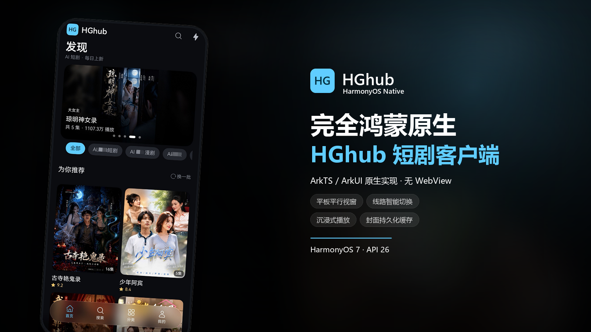
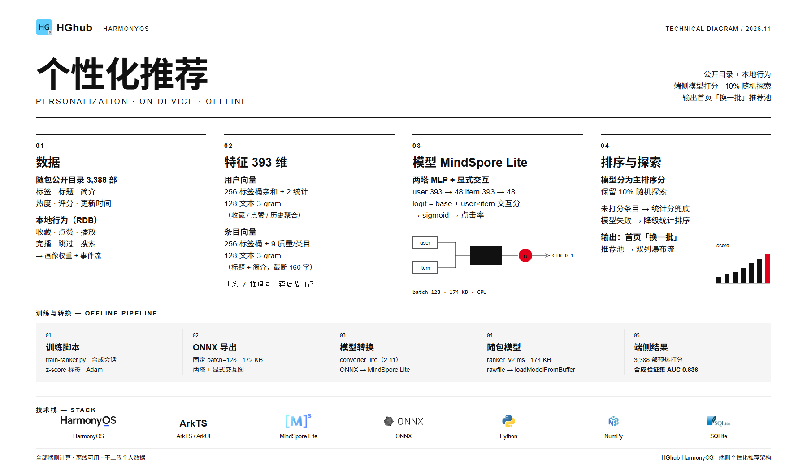
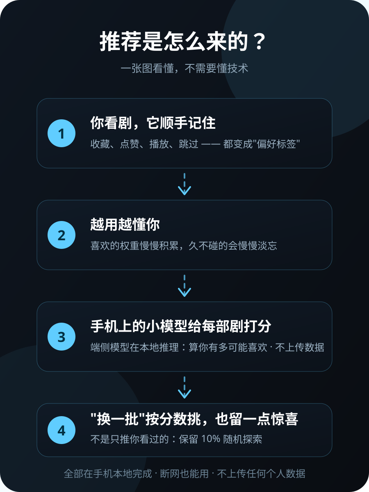

  

<h1 align="center">HGhub Harmony</h1>

  <strong>把黄果短剧装进 HarmonyOS</strong> 
  完全鸿蒙原生的第三方短剧客户端，使用 ArkTS / ArkUI 原生实现浏览、选集与沉浸播放。

  
  
  
  
  

  

  <strong>简体中文</strong>

---

## 完全鸿蒙原生的黄果短剧

黄果短剧的 HarmonyOS 原生客户端：用 **ArkTS / ArkUI** 直接开发，基于 Stage 模型与系统原生组件，不套 WebView、不内嵌 H5。

首页发现、搜索分类、榜单吃瓜、详情选集与沉浸式竖屏播放，全部由原生组件、原生手势、原生播放器与原生系统能力承载；底栏使用系统沉浸光感材质，播放链路带预加载与本地媒体缓存。

  

> 本项目与内容提供方无任何隶属关系，仅供学习与个人使用。

## 原生界面，完整浏览与播放

打开就是内容，滑动就是下一集。

首页用 Hero 推荐加双列瀑布流铺开，切 TAG 不整屏重绘；搜索、分类、榜单、吃瓜各自独立成页，先出骨架再淡入内容。点进详情，封面头图、简介、选集网格与续播入口一屏给全。

播放页是这套体验的核心：AVPlayer 直接解码 HLS，画面交给 XComponent 渲染，不套 WebView、不内嵌 H5。上下滑切剧一次只走一条，横滑调进度，长按 2x，单击收起控件；选集、评论、详情、线路统一收进原生 Sheet，不打断画面。

看得舒服，也看得稳：

| 顺畅 | 稳当 |
| --- | --- |
| 原生手势与原生播放器，滚动、切集、拖动都跟手 | 播放地址失败分级重试，高清不可用自动回退标准 |
| 深色为设计基准，播放页恒深色，文字有 scrim 对比度 | 线路延迟可见，连续失败自动切换，镜像可回主站 |
| 悬浮沉浸底栏 + 系统光感材质，内容延伸到底栏后方 | 崩溃日志与启动耗时只存本机，可随时查看 |

**还有这些**：AI 超分默认开启（系统原生能力，省电模式或电量低于 20% 自动暂停、恢复后自动复原）；网络层按 host 复用连接（减少 TCP/TLS 握手），目标站点有 IPv6 时优先走 IPv6；有 HEVC 源时标题旁出现 `HD`/`SD` 徽章，点一下切换并保留进度；进度条拖到片尾自动续播下一集；锁屏与控制中心能控制播放；退到桌面可以画中画继续看；播放上下文能随应用接续到另一台鸿蒙设备，同网段设备支持投播；桌面卡片：2×2 继续观看（大面积封面 + 顶部标签），2×4 横向收藏影视架（3:4 竖版封面）；专题合集、实时热搜、关注流与用户主页也已就位；冷启动会在后台检查新版本，发现后弹一次窗，点「打开下载链接」直达 Release 页。

## 平板 / 横屏 / 平行视窗

同一份代码，跟着窗口走。

手机上是单栏沉浸；转到平板或横屏，布局按窗口宽度实时重排——瀑布流 2→3/4 列，选集 5→6/7 列，内容最大 960vp 居中，旋转、分屏、折叠都不重建播放器。

窗口 ≥840vp 时默认仍是**全宽多列瀑布流**（不提前分栏）；点开一部剧或一个页面，才带动画进入平行视窗：左侧列表保留，右侧详情/播放，进出与切换都有转场。播放页在右栏里可以点「全屏」临时占满整窗，退出全屏回到分栏。横屏看视频时，评论区收成右侧约 380vp 的侧栏，分页与刷新独立，不打断视频区。

> **平板 / 大屏 / PC 适配说明**：开发者没有平板设备，平板布局（平行视窗、多列瀑布流、全屏切换）尚未实机验证。如果你在平板或大屏设备上遇到界面、交互问题，请通过 [GitHub Issues](https://github.com/stlin256/HGhub-Harmony/issues) 反馈；平板用户在每个版本更新后首次启动时，App 内也会弹出一次提示。

## 个性化推荐（端侧、离线）

「为你推荐」不是随机换一批，而是按你的口味排的。

随包带着一份 3,388 部的公开目录，端侧小模型结合你的本地行为（收藏、点赞、播放、完播、跳过、搜索）给每部剧打分，再留约 10% 随机探索，避免越推越窄。整个链路在手机上完成，不上传任何个人数据，断网也能用。

| 环节 | 做法 |
| --- | --- |
| 数据 | 随包目录 3,388 部 + 本地行为事件（SQLite） |
| 特征 | 393 维：标签桶 + 质量/类目 + 标题简介的字符 3-gram |
| 模型 | MindSpore Lite 两塔 MLP，174 KB，验证集 AUC 0.836 |
| 降级 | 模型不可用时自动回落到统计分排序 |

想弄明白它怎么工作，打开「设置 → 推荐」：「推荐数据」看本地画像标签与打分状态、导入导出画像；「推荐说明」用几张原生步骤卡把原理讲清楚。

给普通用户的一张图版本（App 内「设置 → 推荐 → 推荐说明」同款）

  

## 更少等待，更清楚的状态

| **顺滑** | **清楚** |
| --- | --- |
| 骨架屏与真实布局同构，内容 220ms 淡入；封面按显示尺寸解码、解密放在 TaskPool 后台线程，列表滚动不掉帧。 | 页面级 / 区块级 / 行内三级错误态；保留已加载内容再重试，失败不再只剩一句 Toast。 |
| 封面内存 LRU + 磁盘持久化缓存（缓存键去掉签名参数），冷启动与重复浏览秒开。 | 播放缓冲、起播、失败都有明确状态；选集/评论/详情/线路统一原生 Sheet。 |
| HLS 预加载：提前拉取下一集与 feed 后两条的开头分片，配合本地回环代理媒体缓存，切集/上滑明显更快。 | 播放失败自动区分临时状态错误与真实错误，不会出现「第一次点进去不能播」；返回键二次确认防误退。 |
| 首页/榜单预取与提前翻页；热榜三榜并行预加载，切榜立即渲染，不闪骨架。 | 深色为设计基准，播放页恒深色；视频上文字有 scrim 对比度保证；大字体与平板断点适配。 |
| 底栏 HdsTabs 240ms 页面切换动画，播放器 chrome 140/120ms 渐隐渐显。 | 全屏播放隐藏状态栏、退出恢复；安全区与沉浸式布局统一处理。 |

> 主要交互元素均带无障碍文案（`accessibilityText`），支持读屏与系统无障碍服务。

## 技术栈

| 层 | 选型 |
| --- | --- |
| 语言 / UI | ArkTS（严格模式）+ ArkUI 声明式 |
| 应用框架 | Stage 模型，UIAbility + Navigation/NavPathStack + HdsTabs（UIDesignKit 悬浮沉浸底栏） |
| 播放 | @ohos.multimedia.media AVPlayer（HLS），XComponent 渲染；HLS 预加载 + 本地回环代理媒体缓存 |
| 网络 | @ohos.net.http（统一边缘信封 / 重试 / 线路） |
| 加解密 | AES-128-CBC 封面解密（TaskPool 后台线程执行），PixelMap 渲染 |
| 图片缓存 | 按显示尺寸解码 + 内存 LRU + 磁盘持久化缓存 |
| 存储 | @ohos.data.preferences + AppStorage |
| 工程 | DevEco Studio 26.0.0 / HarmonyOS SDK API 26，hvigor CLI 构建 |

## 隐私与匿名统计

App 冷启动时会上报一次**匿名设备标识**，只用于统计「有多少台设备启动过」：

| 收集 | 不收集 |
|---|---|
| 本地随机生成的 UUID（与硬件无关） | OAID / IMEI / SN / MAC |
| App 版本号、设备型号、系统版本 | 账号、手机号、位置 |
| 首次 / 最近上报时间 | 播放内容、搜索词、行为轨迹 |

- 服务端只保存 UUID 的 **SHA-256**，原始 UUID 不落库、不打日志；IP 仅在内存用于限流
- 设置页「匿名使用统计」可随时关闭，关闭后立即停止上报
- 上报内容：安装时间、App 版本、设备型号、系统版本、当日启动次数 / 使用时长 / 播放次数（VV）/ 崩溃次数
- 上报实现见 [`services/Analytics.ets`](harmony/entry/src/main/ets/services/Analytics.ets)，服务端见 [`telemetry-worker/`](telemetry-worker/README.md)

## 使用须知

- **以访客身份正常使用**：像普通访客一样浏览就好，请勿滥用本项目。
- **上游接口可能变化**：站点接口由第三方提供且随时可能调整。本项目仅用于相关开发学习，**不保证接口与请求的稳定性**；如接口变化导致异常，欢迎通过 [Issues](https://github.com/stlin256/HGhub-Harmony/issues) 反馈或直接提交 PR。
- **不要给站点增加压力**：本项目本身不提供下载功能，请勿改动代码去做批量下载 / 批量抓取，也不要高频轮询、并发轰炸接口或挂机刷播放量；内置的封面与播放列表缓存请不要改小或关掉。
- **尊重内容版权**：不要去除水印与站点标识，不要把剧集搬运、转码、修改后二次分发到别处（网盘、资源站、其他 App 等），更不能改完拿出去出售。
- **不要公开传播接口与直链**：接口地址、播放直链、解密方式请勿公开张贴或打包成「资源站」——站点一旦封禁，所有人都没法再用。
- **不要商业化**：禁止打包出售、接入广告 / 会员 / 付费点播，或作为收费服务的一部分分发（详见 [LICENSE](LICENSE)）。
- **合理使用**：仅供个人学习、研究与自用；请在 24 小时内删除相关资源，并支持正版。
- **遵守当地法律**：使用者应自行判断并承担合规责任。

## 免责声明

- 本项目与内容提供方无任何关联，作者不参与内容的制作、上传与分发。
- 本项目仅在本仓库官方渠道发布；任何第三方修改版（尤其是加卡密、VIP 变现的版本）均与本项目无关，请自行甄别。
- 用户应自行遵守所在地法律法规；因使用本项目产生的任何后果由使用者自行承担。
- 若相关权利方认为本项目存在侵权，请通过 Issue 联系，我们会及时处理。

## 授权声明

[PolyForm Noncommercial License 1.0.0](LICENSE) —— **仅限非商业用途**。

- **允许**：个人学习、研究、自用、爱好项目，以及在非营利组织内部使用；可以自由修改、二次开发。
- **禁止**：任何商业用途。包括但不限于打包出售、接入付费/会员/广告变现、作为收费产品或服务的一部分分发。
- **保留声明**：分发本项目或其修改版时，必须附带本许可证全文（或上面的链接）以及 Required Notice 声明行。

> 历史说明：本项目早期版本以 MIT 发布，已发出的副本继续按 MIT 授权；自 **v1.1.0** 起的新版本一律适用 PolyForm Noncommercial 1.0.0。

## 上游与官方声明

- **本项目官方下载渠道**：[GitHub Releases](https://github.com/stlin256/HGhub-Harmony/releases)。源码页不放任何可执行文件；其余网站、网盘、QQ 群、公众号、第三方下载站分发的「黄果短剧 / HGhub」安装包一律非官方，作者不保证其安全性与完整性。
- 🚫 **已知恶意修改版**：任何在旧版本源码基础上擅自加入**卡密验证、VIP 付费解锁**等变现功能的修改版均与本项目无关，代码改动不透明、安全性无法验证。**请勿下载、勿注册、勿付费**；如已安装，建议立即卸载。
- 本项目**从未、也不会**加入任何卡密 / VIP / 付费解锁 / 广告功能。

## 参与共建

欢迎提交 Issue / PR。开始开发前请先阅读：

- [实施 SPEC](docs/harmony/SPEC.md) 与 [设计规范](docs/harmony/DESIGN.md)
- [环境、签名与真机调试](docs/harmony/ENVIRONMENT.md)

本项目为个人学习项目，Issue / PR 的响应将保持低频率。

  Built for HarmonyOS with care. PolyForm Noncommercial 1.0.0.

