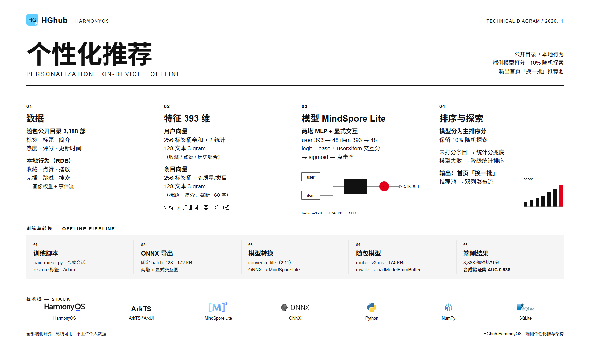

鸿蒙原生HGhub APP v2.1.0 来了 🎉

本次更新最核心的一件事：**我们初步加入了「端侧个性化推荐系统」**——首页「为你推荐」不再只是按分类/热度排列，而是会结合你本机的观看偏好，用手机上的小模型给每部剧打分后再推荐。全部在本地完成，不上传个人数据。

## 个性化推荐（初步）

- **本地画像**：收藏、点赞、播放、完播、跳过、搜索都会在本机累积成偏好标签（RDB 事件库 + 画像，带版本与无损迁移）；
- **随包目录**：内置 3,388 部公开目录（标签 / 标题 / 简介 / 热度 / 评分），安装即有内容，不依赖首屏网络；
- **端侧模型**：MindSpore Lite 小模型在手机上推理，**模型 v2 会看标签、标题和简介**（393 维特征：标签桶 + 质量特征 + 128 维文本 3-gram；两塔 MLP + 显式交互），合成验证集 AUC 0.836；
- **排序策略**：模型分为主排序分 + 保留约 10% 随机探索；模型加载/推理失败时自动降级为统计排序，保证可用；
- **透明可控**：设置 → 推荐 →「推荐数据」可查看本地画像标签、本地计算状态（模型 v2 · 已打分 3,388 部）、导入 / 导出 / 清空画像；「推荐说明」用一张图看懂推荐是怎么来的；
- **隐私**：全部端侧计算、离线可用、不上传个人数据。

## 播放器与体验

- 全屏播放上下滑切剧更稳定：一次手势只切相邻一条，不再因惯性跳到别的视频；
- 起播 / 切剧加载完成前的缩略图现在会跟随上下滑一起移动；
- 播放中自动保持屏幕常亮，暂停 / 结束 / 退后台 / 退出播放页恢复系统熄屏；
- 设置页全部弹窗改为自绘主题化样式，深色模式下不再出现系统配色突兀的弹窗；
- 「推荐数据」「推荐说明」改为独立二级页面（不再用弹窗）。

## 安装

- HarmonyOS 7（API 26）设备安装 `.hap`；当前为测试签名包，仅限已授权设备。
